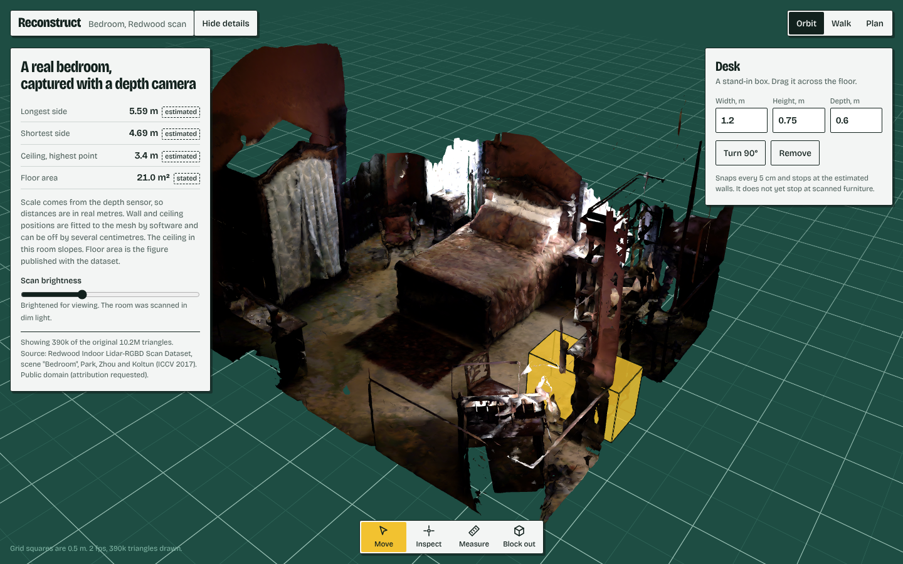
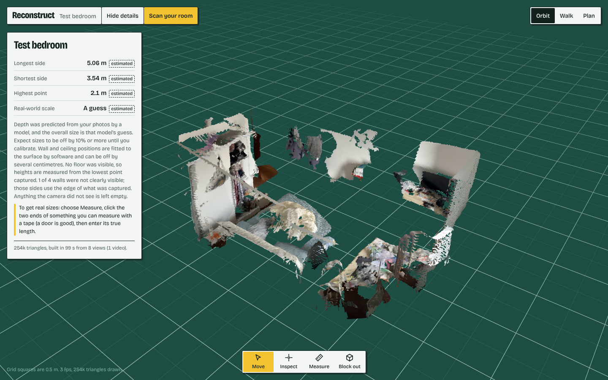

# Reconstruct

Scan a room, then rearrange it in 3D before you buy or move anything.



**Status: Phases 1 and 2 done, first slice of Phase 5 (upload and reconstruct) working.** You can upload
photos or a video of a room and get a 3D version of it to walk around, measure and block out. The
furniture catalogue, AI assistant, budgets and sharing are not built yet. `PLAN.md` has the roadmap and
`LIMITATIONS.md` says exactly what does and does not work.



## Run it

Two processes: the web app, and the Python service that turns photos into 3D.

```bash
# 1. web app
cd apps/web
npm install
npm run dev                      # http://localhost:3000

# 2. reconstruction service (Python 3.10 to 3.13), in a second terminal
cd services/reconstruction
./scripts/setup.sh               # once: installs packages, fetches the model code
uvicorn app.main:app --port 8000
```

The first scan downloads about 1.8 GB of model weights from Hugging Face. No graphics card is needed
(8 views took about 45 s on a 2-core CPU once the models were loaded); with an NVIDIA card it is used automatically.
Without the service the app still opens the sample scan and tells you how to start the service.

## Scanning a room

Click **Scan your room**, add 8 to 16 photos or one slow 10 to 30 second video, and press **Build 3D room**.
Stand in each corner and shoot toward the opposite one, with the lights on and the floor in frame.
The room's size is a model's guess at first. To make it real, use **Measure** on something you can check
with a tape (a door works well) and enter its true length.

## What you can do now

- Upload photos or video and get your own room in 3D, then calibrate its size with one real measurement.
- Orbit, pan and zoom around the room; walk through it in first person; view it in plan.
- Measure between any two points on the scan, and read the height of any point.
- Add furniture-sized block-out boxes, drag them on the floor (5 cm snap, stopped by the estimated walls),
  resize, turn and remove them.
- See which dimensions are estimated and which were stated by the data source.

Keys: `V` move, `I` inspect, `M` measure, `B` block out, `1` `2` `3` views, `R` turn, `Delete` remove, `Esc` clear.

## Documents

- `ARCHITECTURE.md`: how the code is organised and why
- `DESIGN_SYSTEM.md`: the visual language and its tokens
- `PLAN.md`: phases, what is done, what is next
- `LIMITATIONS.md`: known limits, supported inputs, test results

## Demo scan credit

The bedroom is the "Bedroom" scene from the Redwood Indoor Lidar-RGBD Scan Dataset
(Park, Zhou, Koltun, *Colored Point Cloud Registration Revisited*, ICCV 2017), which its authors
placed in the public domain with a request for attribution. http://redwood-data.org/indoor_lidar_rgbd/
