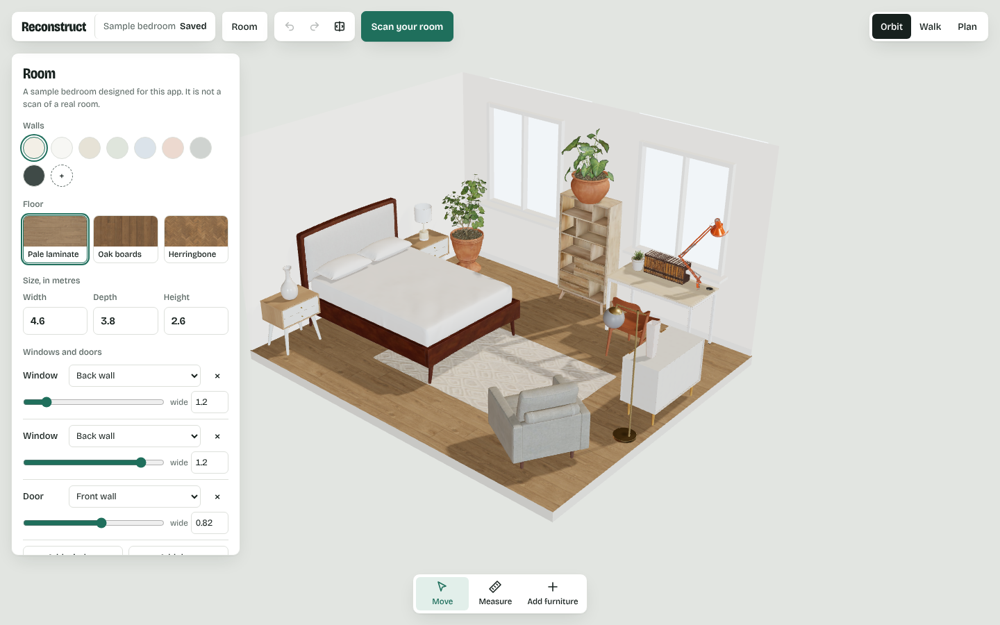
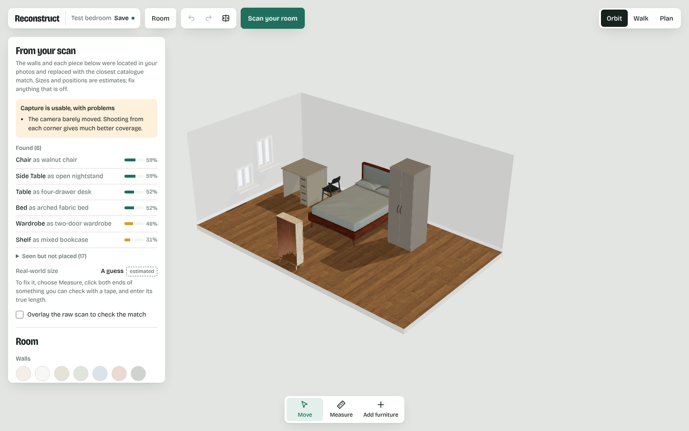
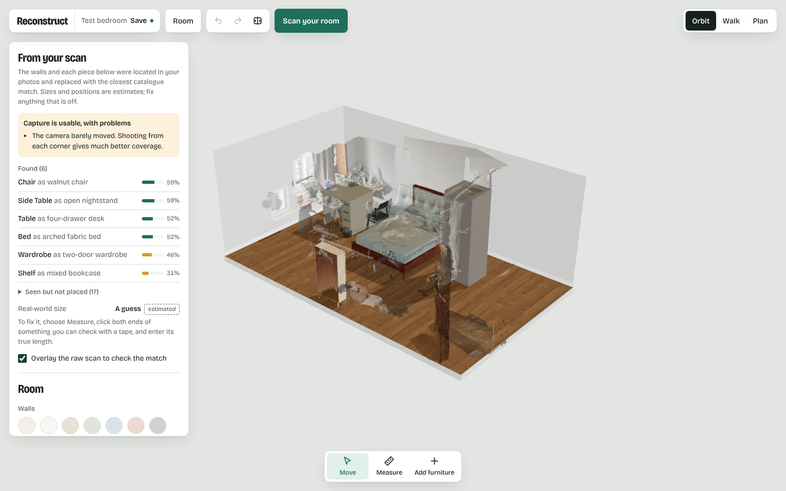
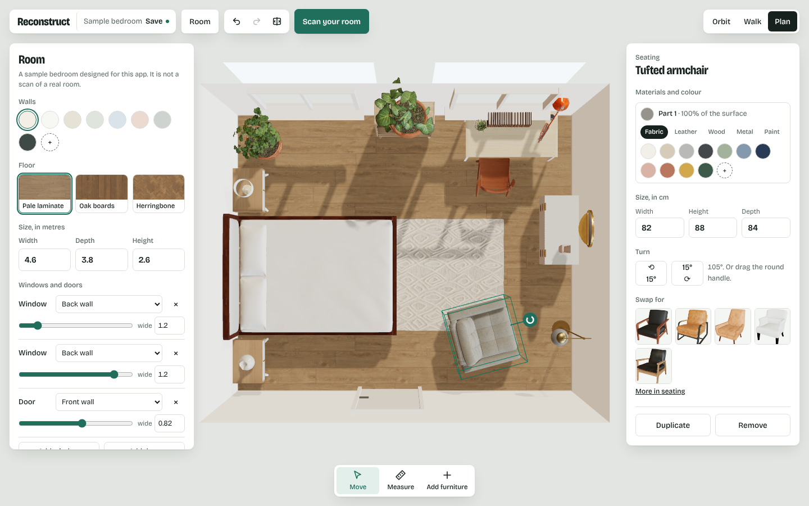
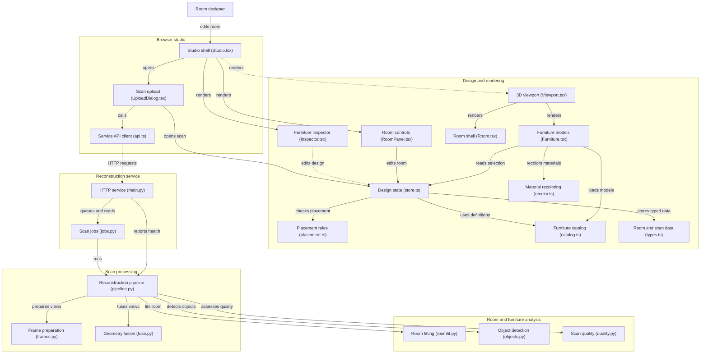

# Reconstruct

Turn photos of a bedroom into an editable 3D room, then redesign it: move, swap, resize and recolour the furniture, change the walls and floor, and compare before and after.

**Live:** https://anikakesavan.github.io/reconstruct/



## What it does

**Scan** (needs the Python service; see below)
- Upload 8 to 16 photos or a short video of a room.
- The service estimates depth and camera positions, fits the floor and walls, then finds each piece of furniture, window and door
  and works out where it is in 3D.
- The room opens as an **editable reconstruction**: clean walls at the estimated size, and a catalogue piece standing in for each
  thing it found, in a similar colour, each with a confidence score. You can overlay the raw scan to check the match.

**Edit** (runs entirely in the browser)
- Click a piece to move it, turn it with the handle, resize it, swap it, duplicate or remove it, or put it back where it was found.
- Recolour each part of a piece (fabric, leather, wood, metal, paint) with its texture and shading kept.
- Pieces cannot be left overlapping; wall pieces stick to walls; things on a desk move with the desk.
- Add from a 77-piece catalogue of real product models. Edit walls, flooring, room size, windows and doors.
- Undo and redo, named saves in the browser, download a design file, before-and-after slider, orbit / plan / walk views, measuring.

| Rebuilt from 8 photos of a real bedroom | The same, with the raw scan overlaid | Editing a piece |
|---|---|---|
|  |  |  |

**Be clear about the limits.** The reconstruction is a recognisable layout built from lookalike pieces, not a copy of your furniture.
Sizes are estimates, some things are missed or mislabelled, and clutter is ignored. `LIMITATIONS.md` has specifics and the test record.

## Architecture

The browser studio handles room editing and sends photo or video scans to the reconstruction service.



[Open the interactive diagram on GitDiagram](https://gitdiagram.com/anikakesavan/reconstruct)

## Run it

```bash
# web app
cd apps/web && npm install && npm run dev          # http://localhost:3000

# reconstruction service (Python 3.10 to 3.13), second terminal, only needed for scanning
cd services/reconstruction
./scripts/setup.sh                                  # once
uvicorn app.main:app --port 8000
```

The first scan downloads about 2 GB of model weights. No graphics card is needed: 8 photos took about a minute and a half on a 2-core CPU.
To make scanning work on the live site without anything running locally, see `services/reconstruction/HOSTING.md`.

Keys: `V` move, `M` measure, `R` / `Shift+R` turn, `Delete` remove, `Ctrl/Cmd+Z` undo, `Shift+Ctrl/Cmd+Z` redo, `Ctrl/Cmd+D` duplicate, `Ctrl/Cmd+S` save, `1` `2` `3` views.

## Documents
`ARCHITECTURE.md` · `DESIGN_SYSTEM.md` · `PLAN.md` · `LIMITATIONS.md` · `ASSETS.md` (credits and licences)
